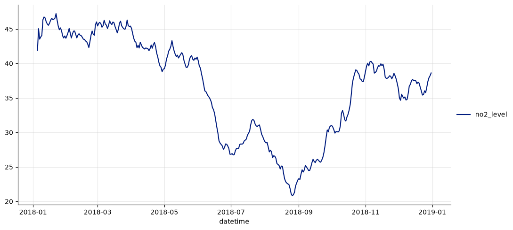
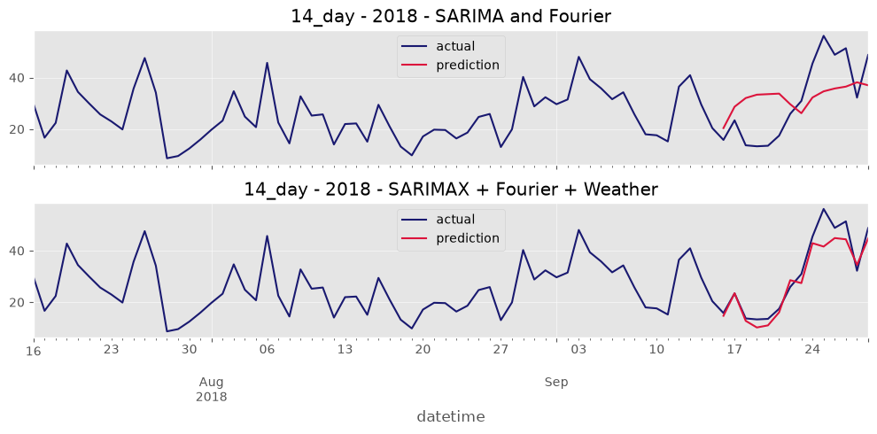
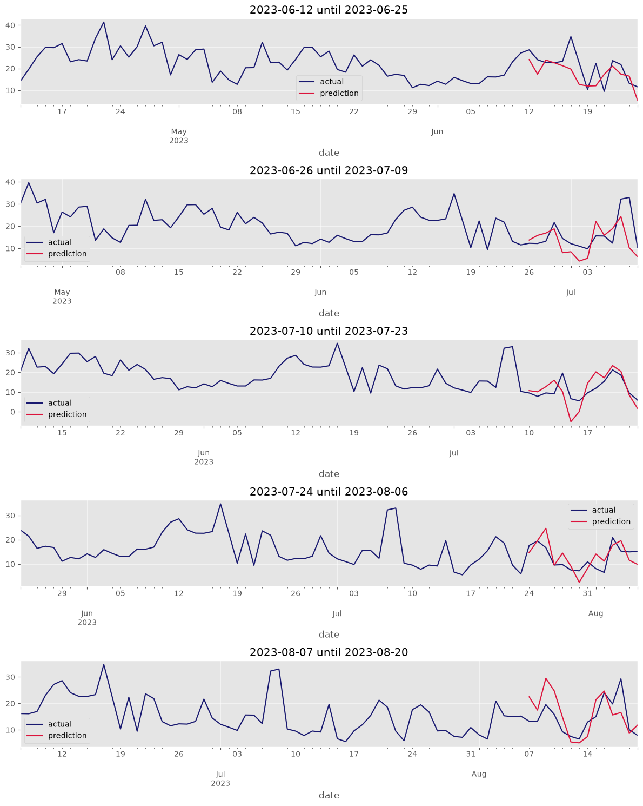

<div align="center">

# Predicting London’s air quality

### From missing measurements to 14-day NO₂ forecasts

**A time-series project following one London monitoring site through data cleaning, imputation, weather features, and walk-forward forecasting.**

`Python` · `pandas` · `SARIMAX` · `Open-Meteo` · `time-series evaluation`

</div>

---

> **The result:** Adding weather features cut the mean absolute error on each tested long missing-data gap. The final walk-forward forecasting experiment averaged **5.57 MAE** and **6.79 RMSE** across 14-day windows. These are historical evaluation results, with the limitations explained below.

## The question

Can historical measurements of nitrogen dioxide (NO₂) help forecast daily air quality in London? I focused on **Camden – Bloomsbury**, one monitoring site, so I could work through the full modelling problem: noisy daily values, missing periods, seasonal patterns, and the possible influence of weather.

The air-quality CSV in this repository comes from the **London Air Quality Network**, via the **Environmental Research Group at Imperial College London**. It contains several sites and pollutants. The notebook selects Camden – Bloomsbury and NO₂, converts the hourly records to daily values, and concentrates its forecasting analysis on data from 2015 onward. Historical weather variables are retrieved from the Open-Meteo archive API.

| Project at a glance | |
| --- | --- |
| **Target** | Daily NO₂ level at Camden – Bloomsbury |
| **Main challenge** | Missing measurements, including gaps lasting multiple weeks |
| **Models** | Seasonal ARIMA/SARIMAX with annual Fourier terms and weather features |
| **Evaluation** | Masked-gap tests and 14-day walk-forward forecast windows |
| **Project files** | [Notebook](NO2_london.ipynb) · [Dataset](data/london_air_quality_2010_2023_top5_sites.csv) · [Dependencies](requirements.txt) |

## 1. Finding the pattern beneath the noise

The daily NO₂ readings were noisy enough that the annual pattern was hard to see at first. I plotted a **30-day rolling mean** year by year. That revealed lower levels in summer, higher levels in winter, and a broader downward trend. Those observations shaped the later model design: a weekly seasonal component and Fourier terms to represent the annual cycle.



*A 2018 view from the notebook. The rolling mean makes the seasonal shape easier to see; it is not the series used as the forecasting target.*

## 2. Deciding what to do with missing days

The daily series also contained missing values. A one-day gap is different from a 56-day gap, so I first measured the lengths of the missing periods. I then hid known values in test windows and compared **time interpolation**, **seasonal naive estimates**, and **rolling-mean approaches** using MAE and MAPE.

Time interpolation performed best among those simple methods on the tested short gaps, so I used it for gaps of **up to seven days**. The longer gaps needed a model that could follow the time-series structure. I tested weekly SARIMA configurations, added Fourier terms for annual seasonality, and ranked candidate configurations with AIC. For imputation, Kalman smoothing let the model use observations on both sides of a missing period.

That seasonal model followed the broad trend, but it missed much of the day-to-day movement. This suggested another source of information might matter.

## 3. Bringing in weather

Weather could help explain some of the variation in NO₂. I added historical **temperature, wind speed, and precipitation** features from Open-Meteo, then repeated the model selection and masked-gap evaluation. The candidate highlighted in the article, **SARIMAX `(1,1,2) × (0,1,1,7)`**, improved on the Fourier-only version for all three reported gap lengths:

| Masked gap | MAE: Fourier terms | MAE: Fourier + weather | Reduction |
| --- | ---: | ---: | ---: |
| 14 days | 10.03 | **5.86** | 42% |
| 25 days | 8.67 | **6.94** | 20% |
| 56 days | 8.75 | **5.50** | 37% |



*One masked-gap example from the notebook. The weather-enhanced prediction follows the observed changes more closely in this window.*

The improvement was the clearest result of the project. After the comparison, I used the weather-enhanced model to fill the remaining long gaps before moving to forecasting.

## 4. Forecasting 14 days at a time

With a completed series, I used an **80/20 chronological split** and walk-forward evaluation. Each iteration predicted the next **14 days**, scored that window, then added its observed values to the training history before the next prediction. The notebook reports **SARIMAX `(1,1,1) × (2,1,1,7)`** as its best forecasting configuration, averaging **5.57 MAE** and **6.79 RMSE** across the windows.



*Five forecast windows from the end of the test period. The red segments show each 14-day prediction against the blue observed series.*

### What the result does—and does not—show

The evaluation shows useful historical performance for this site and period. It is not a live air-quality forecast. The notebook **treats earlier imputed values as ground truth** for the later forecasting experiment, so its scores inherit uncertainty from the missing-data step. Its weather inputs come from historical data; operational forecasts would also depend on the accuracy and availability of future weather predictions. The model captures much of the pattern but still misses some daily variation.

The main lesson for me was how much the weather features improved the result after the seasonal model had already captured the larger trend. A next step would be to compare this approach with alternatives such as gradient-boosted trees or other forecasting models under the same time-aware evaluation.

## Explore the notebook

The complete analysis, plots, model selection, and evaluation are in [`NO2_london.ipynb`](NO2_london.ipynb). To run it locally, start in the repository root:

```bash
python3 -m venv .venv
source .venv/bin/activate
python -m pip install -r requirements.txt
```

On Windows, activate the environment with `.venv\Scripts\activate` instead. Open the notebook in PyCharm or another notebook editor, select the new environment as its kernel, and use the repository root as the working directory. The CSV is already included under `data/`. The weather section needs internet access and creates a local `.cache.sqlite` file, which Git ignores. The model searches and walk-forward evaluation take time; one evaluation is noted as roughly **18 minutes** on the original setup.

---

*Project and analysis by Mathias Vandenbossche.*
